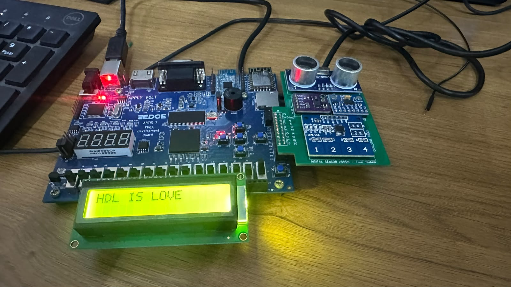
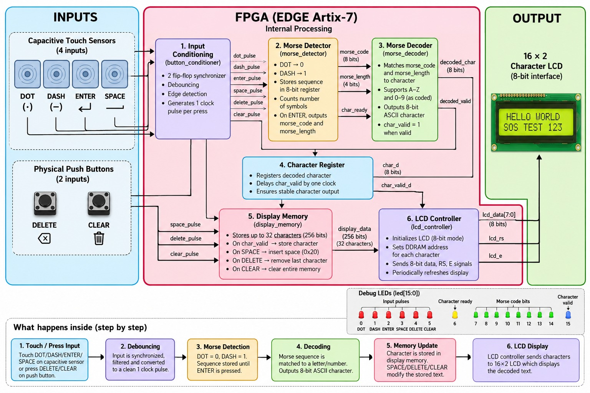
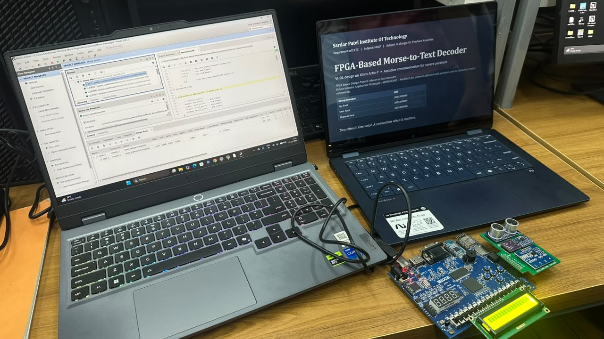

# FPGA-Based Morse Code to Text Converter

A VHDL-based digital system that converts Morse code into readable text using the **EDGE Artix-7 FPGA (XC7A35T-1FTG256)**.

Users enter Morse sequences through capacitive touch sensors. The FPGA processes and decodes the sequences, displaying the resulting characters on a 16x2 LCD.

## Features

* Touch-based Morse code input using dots and dashes.
* Decoding of uppercase English alphabets (A-Z) and digits (0-9).
* 16x2 LCD text display.
* Delete and clear functionality.
* Space insertion between words.
* Input synchronisation, debouncing and edge detection.
* Modular VHDL implementation.

## Hardware Requirements

| Component                | Purpose                           |
| ------------------------ | --------------------------------- |
| EDGE Artix-7 FPGA        | Main processing unit              |
| Capacitive Touch Sensors | Dot, dash, enter and space inputs |
| Push Buttons             | Delete and clear operations       |
| 16x2 LCD                 | Display decoded text              |
| 50 MHz Clock             | System timing                     |

### Input Mapping

| Input         | Function       |
| ------------- | -------------- |
| Touch OUT1    | Dot (.)        |
| Touch OUT2    | Dash (-)       |
| Touch OUT3    | Enter / Decode |
| Touch OUT4    | Space          |
| Push Button 1 | Delete         |
| Push Button 2 | Clear          |

## System Architecture

The project consists of six independent VHDL modules:

| Module                   | Function                                             |
| ------------------------ | ---------------------------------------------------- |
| `morse_top.vhd`          | Top-level module connecting the system               |
| `button_conditioner.vhd` | Input synchronisation, debouncing and edge detection |
| `morse_detector.vhd`     | Captures and stores Morse sequences                  |
| `morse_decoder.vhd`      | Converts Morse patterns into ASCII characters        |
| `display_memory.vhd`     | Manages decoded text, spaces, deletion and clearing  |
| `lcd_controller.vhd`     | Controls LCD initialisation and data transfer        |

### System Workflow

1. User enters dots and dashes through touch sensors.
2. Input conditioning generates clean input pulses.
3. Morse detector stores the binary sequence.
4. ENTER triggers the decoding process.
5. Morse decoder generates the corresponding ASCII character.
6. Display memory stores and manages the decoded text.
7. LCD controller displays the text on the 16x2 LCD.

### Morse Code Representation

| Symbol   | Binary |
| -------- | ------ |
| Dot (.)  | `0`    |
| Dash (-) | `1`    |

The detector stores sequences of up to 8 symbols. The decoder supports sequence lengths of 1 to 5, covering all 26 English alphabets and 10 decimal digits. Unsupported patterns produce `?`.

## Project Demonstration

### Complete Hardware Setup

EDGE Artix-7 FPGA connected to the capacitive touch interface and LCD.

### System Architecture

### Development Setup

## FPGA Pin Configuration

**Target Device:** XC7A35T-1FTG256

### Clock

| Signal       | Pin | Frequency |
| ------------ | --- | --------- |
| System Clock | N11 | 50 MHz    |

### Inputs

| Function | FPGA Pin |
| -------- | -------- |
| Dot      | P14      |
| Dash     | P10      |
| Enter    | P11      |
| Space    | R12      |
| Delete   | M14      |
| Clear    | K13      |

### LCD Interface

| Signal       | FPGA Pin |
| ------------ | -------- |
| LCD RS       | P5       |
| LCD Enable   | T3       |
| LCD Data [0] | P3       |
| LCD Data [1] | M5       |
| LCD Data [2] | N4       |
| LCD Data [3] | R2       |
| LCD Data [4] | R1       |
| LCD Data [5] | R3       |
| LCD Data [6] | T2       |
| LCD Data [7] | T4       |

Complete pin assignments and electrical constraints are available in `constraints/morse_top.xdc`.

## How to Run

### Requirements

* AMD Xilinx Vivado Design Suite
* EDGE Artix-7 FPGA development board
* Capacitive touch sensors
* 16x2 LCD

### Setup Instructions

1. Clone or download this repository.
2. Open Vivado and create a new RTL project.
3. Select device `XC7A35T-1FTG256`.
4. Add all six `.vhd` files from the `src` directory.
5. Add `constraints/morse_top.xdc`.
6. Set `morse_top` as the top-level module.
7. Run synthesis and implementation.
8. Generate the bitstream and program the FPGA.

## Future Improvements

* Support for additional Morse code symbols and punctuation.
* Improved user interface and input feedback.
* Wireless communication capabilities.
* Development of a compact wearable prototype.

## Authors

* **Smit Patil**
* **Jay Patil**
* **Bhavesh Patil**

Sardar Patel Institute of Technology
Department of Electronics and Telecommunication Engineering
